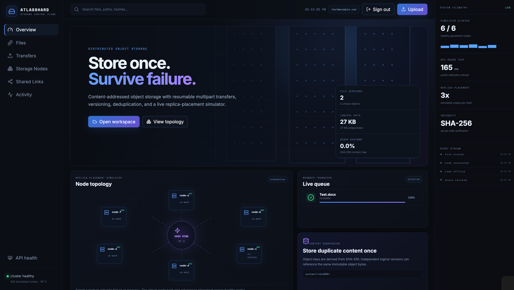
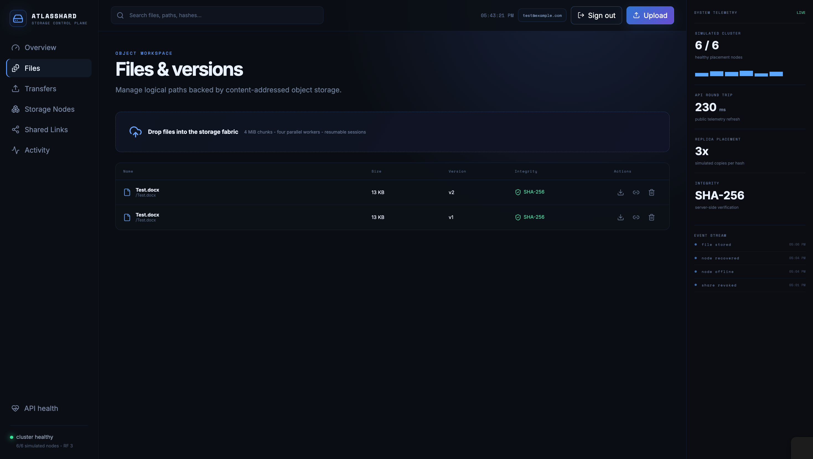
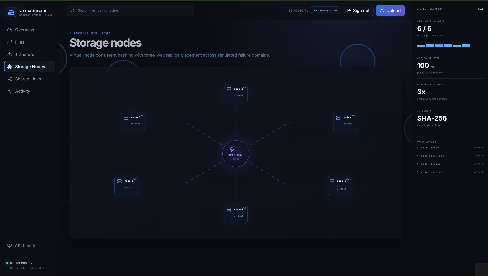
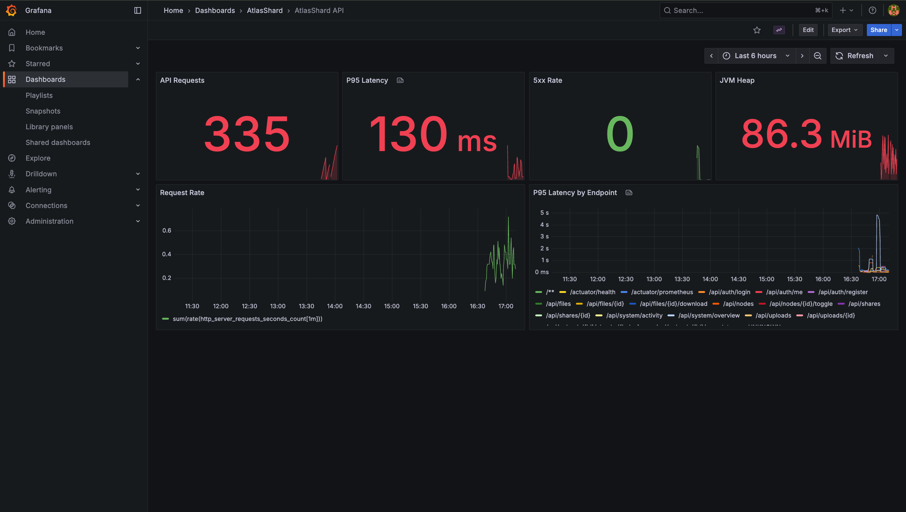

# AtlasShard

AtlasShard is a cloud storage project I built to learn more about backend development, distributed systems, file storage, and system monitoring.

Users can create an account, upload files, download them, create different versions of the same file, and generate temporary sharing links. The project also has a storage node simulator where nodes can be taken offline and recovered.

## Screenshots

### Overview


### Files and Versioning


### Storage Nodes


### Grafana Monitoring



## Features

- User sign up and login
- Upload and download files
- Chunked file uploads
- Resumable uploads
- File versioning
- Delete files
- SHA-256 file verification
- File deduplication
- Temporary share links
- Revoke share links
- Storage node failure and recovery simulation
- Activity tracking using Kafka
- PostgreSQL database
- Redis caching
- S3-compatible object storage
- Prometheus monitoring
- Grafana dashboard

## Technologies Used

**Frontend**
- React
- TypeScript
- Vite

**Backend**
- Java
- Spring Boot
- Spring Security
- Spring Data JPA

**Database and Infrastructure**
- PostgreSQL
- Redis
- Apache Kafka
- S3-compatible object storage
- Docker

**Monitoring**
- Prometheus
- Grafana

## How It Works

```text
React Frontend
      |
      v
Spring Boot Backend
      |
      +---- PostgreSQL
      |
      +---- Redis
      |
      +---- Kafka
      |
      +---- Object Storage
```

Files are uploaded in chunks and checked using SHA-256. File information is stored in PostgreSQL, while the actual file contents are stored in object storage.

If a file with the same path is uploaded again, AtlasShard keeps the previous copy and creates a new version.

## Storage Node Simulator

The project also includes six simulated storage nodes.

It uses consistent hashing to decide where file replicas would be placed. A node can be taken offline to see how the cluster reacts, and it can later be recovered.

This part of the project helped me understand concepts such as replication, node failures, consistent hashing, and fault tolerance.

## Running the Project

First create the environment file:

```bash
cp .env.example .env
```

Then start the project with Docker:

```bash
docker compose up --build
```

Open the application at:

```text
http://localhost:5174
```

Grafana:

```text
http://localhost:3001
```

Prometheus:

```text
http://localhost:9091
```

## Monitoring

The Grafana dashboard displays information such as:

- API requests
- request rate
- P95 latency
- server errors
- JVM memory usage
- latency for different API endpoints

## Project Goal

The main goal of this project was to build something more complex than a normal file upload application and learn how different backend technologies can work together in one system.

I used this project to practice Java and Spring Boot while also learning more about Docker, Kafka, Redis, object storage, monitoring, and distributed system concepts.
